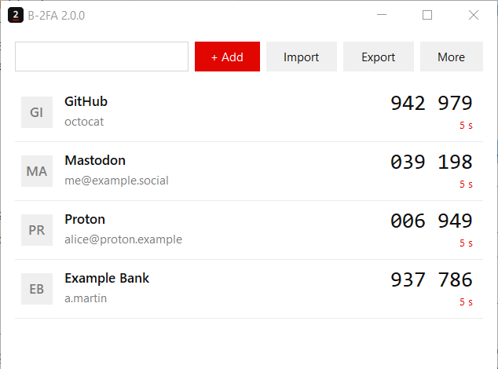

# B-2FA

**Your 2FAS codes on your PC, without your phone.**

B-2FA is a small native Windows program (C++, plain Win32, 0.6 MB, nothing to install first) that
reads a [2FAS](https://2fas.com) backup and shows the one-time codes (TOTP, HOTP, Steam Guard) in a
window. It keeps the accounts in an encrypted vault on your PC, so you can get a code when the phone is
not at hand, and it can export a backup that the 2FAS phone app imports back.

> **Security warning.** A code generator on the same computer as your passwords is, by design, a weaker
> second factor than a separate phone: anyone who gets your unlocked PC and your master password gets
> your codes. B-2FA has **not been audited by a human security professional** (see
> [Security](#security)). Keep your phone as the reference copy, use a long master password, and do not
> rely on this software for anything where losing the account would be serious without understanding
> these limits. It comes with no warranty (see [License](#license)).

> **Transparency note.** B-2FA was designed, directed and tested by hand by Benoit Saint-Moulin, and
> written with the help of an AI coding assistant. The code is also covered by automated tests and was
> reviewed by two independent automated AI audits, whose findings were fixed. It may nevertheless contain
> errors. Read the code before you trust it with secrets that matter.

> **Not affiliated with 2FAS.** B-2FA is an independent project. It is not made, endorsed or supported
> by 2FAS. "2FAS" is the name of their product.

## Features

- Import a 2FAS backup (`.2fas`, encrypted or not). Accounts already present (same secret) are skipped.
- Codes for TOTP (SHA1, SHA256, SHA512, 4 to 10 digits, any period), HOTP and Steam Guard, with the
  seconds left shown in small text under each code.
- Click an account to copy its code. The clipboard is cleared after 30 s and on exit.
- Add, edit and delete accounts, by hand or from an `otpauth://` link. The technical settings (type,
  algorithm, digits, period) sit behind "Advanced options" because nearly every service uses the defaults.
- Export an encrypted `.2fas` backup for the 2FAS phone app (16 characters minimum, different from the
  master password). It is also the recovery backup of a vault bound to this PC (see below).
- **On-screen shuffled keypad** on demand for the PIN and the passwords, against keyloggers (see below).
- Optional PIN (6 to 10 digits) for quick unlock on this PC (a convenience, not a lock: see [Security](#security)).
- Automatic backups of the vault, locking after 2 minutes without input (and when Windows locks or sleeps), and screen capture protection.
- Service logos from the official 2FAS pack, installed on demand (see [Logos](#logos)).
- No network access: the program never connects to the internet.
- One static executable: no Python, no .NET, no Visual C++ runtime, no DLL to ship.

## On-screen keypad (anti-keylogger)

A keylogger records the keys you press. B-2FA lets you enter the PIN, and any password, with the mouse on a
keypad whose keys are in a random order:

- The PIN is typed on the keyboard by default. A "Virtual keyboard" link under the field shows the PIN
  keypad whenever you want it (for example on a PC you do not trust): its keys are reshuffled after **every**
  digit and the physical keyboard is ignored while it is shown. To use it every time, tick
  More > Always use the keypad for the PIN.
- Every password prompt has a "Virtual keyboard" link: three pages (lower case, upper case, digits and
  symbols), reshuffled each time a page is shown, with the physical keyboard switched off while it is open.
  Paste still works, so a password manager can fill the field.
- The window is excluded from screen capture, so a program that records mouse clicks cannot photograph the
  layout to learn which key sits where. The characters on the keys are drawn, and are neither the text nor
  a property of the key windows, so another program cannot read them with the usual window functions (a
  program that reads this program's memory still can: see the limits).

This is **not** what products like KeyScrambler do. They install a keyboard driver that encrypts keystrokes
inside the system, which an ordinary program cannot do. The keypad protects against loggers that only record
the keyboard (hooks, hardware keyloggers). It does not protect against malware that reads the program's
memory, reads the field's text, or controls the whole session. Typing the password on the physical keyboard
is of course still exposed to a keylogger.

## Download

Windows 10 or 11, 64-bit. Get the files from the [Releases](https://github.com/bsm3d/B-2FA/releases) page:

| File | Use |
|---|---|
| `B-2FA-<version>-Setup.exe` | Installer (needs administrator rights, installs in `Program Files`). |
| `B-2FA-<version>-portable.zip` | Portable version: unzip and run `B-2FA.exe`. |

The programs are not code-signed, so Windows SmartScreen may warn on the first launch. Check the SHA-256
checksum given with each release before you run it.

## Using it

1. First launch: choose a **master password** (16 characters minimum: a passphrase of 4 or 5 random words
   works well). It cannot be recovered. Leave "Bind to this PC" ON unless you need to restore the vault elsewhere.
2. **Import** your 2FAS backup (in the phone app: Settings, Backup, export to a file), or **+ Add** an
   account by hand.
3. Click an account to copy its code. Right-click for Edit and Delete.
4. Optional: **More > Set or change PIN** for a quicker unlock. The master password stays the real key.

## Security

What protects your data:

- The vault is encrypted with AES-256-GCM, with a key derived from the master password by scrypt
  (256 MiB of memory, N = 2^18, about 0.4 s per guess). The master password has at least 16 characters.
  The header is authenticated, writes are atomic, and a save is refused if another program changed the
  vault file.
- **A stolen or copied vault file is useless without this PC (the default).** A new vault is bound to this PC:
  its key also depends on a random secret wrapped by Windows (DPAPI) for this Windows account, kept in
  `device.b2fa` next to the vault. The vault file alone (from a stolen disk, a server backup, a cloud copy,
  an e-mail) does not open anywhere else, not for another Windows account, not even with the right master
  password. This does not stop a program running as you, which can unwrap the secret like B-2FA does: against
  it, only the strength of the master password counts.
  **The price:** the vault, its automatic backups and `.bak` are bound the same way, so they do not open on
  another PC or after your Windows profile is lost or its local password is reset. The way back is a
  **recovery export** (`.2fas`, opens anywhere with its own password), and your phone. B-2FA tells you when
  creating the vault, offers the export when the first accounts are in, and shows a red reminder
  until you have exported. Untick "Bind to this PC" when you create the vault to get a vault that restores
  anywhere with its password.
- Backups made by the program are copies of the vault (same protection). Changing the master password or
  deleting an account deletes the old copies so none outlives the change.
- Every save is read back and decrypted before anything older is deleted, a vault that would be too big to
  read again is refused, and creating a new vault next to backups of an earlier one moves those backups to
  a folder of their own instead of overwriting them.
- The 2FAS backup format is weaker than the vault: it uses PBKDF2-HMAC-SHA256 with only 10 000
  iterations. That is the phone app's format, so an exported `.2fas` is only as strong as its password.
  B-2FA asks for at least 16 characters, different from the master password.
- The PIN does not protect the vault file. It only opens a small side file (`pin.b2fa`) that holds the
  master password wrapped by Windows DPAPI (this Windows account only) with the PIN, stretched by scrypt
  (512 MiB, about 0.7 s), as extra entropy. A PIN has 6 to 10 digits. The side file is erased after 5
  wrong PINs typed in the program, and when the master password changes.
  **Be clear about what it is:** any program running as your Windows account can copy `pin.b2fa` and try
  PINs offline, without the 5-attempt counter. The 0.7 s of 512 MiB per guess only slows it down: about 8 days
  on one core for 6 digits (hours with many cores), about 2 years for 8 digits, and centuries for 10. A PIN is
  a convenience for a PC nobody else uses, not a second lock. If you do not accept that, do not set one.
- A brake on guessing at the unlock screen, for the PIN and for the master password: 3 wrong tries are
  free, then the next try is only possible 30 s after the last wrong one, and so on. The count is kept in
  `unlock-guard.json`, so closing and reopening the program gives nothing back; a right password or PIN
  resets it, and a wrong try does not cost key derivation time while you wait. It stops someone at your
  keyboard. It does not stop a program that copied the vault file and guesses offline: against that, only the
  strength of the master password counts. Change the numbers in `settings.json` with `unlock_free_attempts`
  (1 to 10) and `unlock_delay_seconds` (5 to 3600).
- The window is excluded from screen captures (Print Screen, Snipping Tool, screen sharing, recorders):
  they get a black picture saying "No screen capture allowed". Switch it off for the session with
  More > Block screen capture (or start with `--allow-capture`). Windows 10 build 19041 or later.
- The window ignores commands that other programs post to it unless they fit its state (a dialog open, the
  right screen, one of its own controls), and its menu choices are never received as messages. Locking happens
  when you minimise, after 2 minutes without real keyboard or mouse input (a message posted by another
  program does not count), and when Windows locks or goes to sleep.
- It loads DLLs from System32 only and refuses images from remote or low-integrity locations, so a DLL planted
  next to `B-2FA.exe` (for example in a Downloads folder with the portable version) is not loaded. This was
  tested with 133 planted fake DLLs.
- Codes go to the clipboard excluded from Windows clipboard history and cloud sync, and are cleared after
  30 s and when the program closes (retried if the clipboard is busy; not if the program is killed or the
  PC crashes).
- The cryptography comes from Windows (CNG), except scrypt, which Windows does not have and which is
  written in this project and checked against the RFC 7914 test vectors.
- The vault key, the PIN, the passwords and the decrypted accounts are overwritten with zeros in the
  program's memory when you lock the vault. Every text of a loaded document is wiped when the document goes
  away, and the temporary copies made along the way are wiped as soon as they are used. This was checked by
  scanning the whole process memory after a lock (adding, importing, editing and exporting included): no copy of
  a secret was left.

Known limits:

- Traces of a secret can still exist in memory the program does not control (the text box of the
  window, the system's own buffers, a swap file). While the vault is unlocked, the master password and the
  accounts are in memory (the master password is needed to set a PIN).
- Message boxes and menus are not excluded from screen capture: they can show an account name.
- Screen capture protection does nothing before Windows 10 build 19041 (the menu entry is then absent).
- Deleting an account deletes every automatic backup too, so there is no undo (the dialog says so). The
  `earlier-vault-*` folders that creating a new vault may leave in `backups\` are never deleted by the
  program: they hold the old vault, still encrypted with its old master password.
- The Windows file dialog, which is part of Windows, loads network components of its own; B-2FA's code has
  no network function and the build refuses to link one.
- Not built with Spectre mitigations, and not code-signed.
- Malware already running as you can read what you can read: the PIN file (and try PINs on it, see above),
  the clipboard, the screen, and this program's memory (including the keypad layout).
- A photo of the screen is not stopped by the capture protection.
- An old copy of the vault restored over a newer one is not detected (no rollback protection).
- The program has had no review by a human security professional.

To report a security problem, open an issue on GitHub without publishing a working exploit, or contact
the author through [www.bsm3d.com](https://www.bsm3d.com).

## Your data

Everything lives in `%APPDATA%\BSM\B-2FA` (override with the `B2FA_HOME` environment variable):

- `vault.b2fa`: the accounts, encrypted with the master password (and the device key, if bound).
- `device.b2fa`: the device key, wrapped by Windows for your account (only if the vault is bound).
- `vault.b2fa.bak`: the previous version of the vault.
- `backups\`: the last 10 automatic copies of the vault. To restore one, copy it over `vault.b2fa`.
- `pin.b2fa`: the PIN side file, if you set a PIN.
- `settings.json`: the few settings (nothing secret), and the public id of the vault that was exported.
- `icons\`: the logo pack, if you installed it.

Install, update and uninstall never touch this folder. The master password cannot be recovered.

## Logos

The service logos belong to 2FAS and are **not** under the GPL (their repository says so), so they are not
part of this project. To show them on your own PC, run once (needs `git`, about 13 MB):

    powershell -ExecutionPolicy Bypass -File tools\fetch_icons.ps1

It downloads the logo pack from a pinned commit of the 2FAS Android repository into `%APPDATA%\BSM\B-2FA\icons`. Keep it
for your own use and do not redistribute it. Without the pack, B-2FA shows a letter tile.

## Build

Needs the Visual Studio 2022 Build Tools (C++ workload), CMake, and, for the installer only,
[Inno Setup 6](https://jrsoftware.org/isinfo.php).

    powershell -ExecutionPolicy Bypass -File tools\build.ps1

It builds the program (warnings are errors), runs the tests, checks that the executable imports no runtime or network DLL, then builds
`B-2FA-<version>-Setup.exe` and the portable zip into `..\distributions\B-2FA\` and prints their SHA-256.
For the program alone:

    cmake -S . -B build -G "Visual Studio 17 2022" -A x64
    cmake --build build --config Release

The window can also be driven by scripts for GUI tests: configure with `-DB2FA_TEST_HOOKS=ON` (a separate
build folder) to let the menu commands arrive as messages. A release build never has this: it is off by
default and `tools\build.ps1` does not turn it on.

## Tests

    build\Release\b2tests.exe

About 400 checks: the RFC 4226, 6238, 4231 and 7914 vectors, a NIST AES-GCM vector, the JSON reader, the
vault (create, unlock, change password, export, merge, damaged files, a vault changed behind its back),
the 2FAS format, the PIN (attempt counting, wiping), the settings and the keypad shuffle. They also open
files made by an earlier Python prototype of B-2FA (`tests/vectors`) and check that the codes match.

The backup format is the one of the 2FAS apps ([github.com/twofas](https://github.com/twofas)):
PBKDF2-HMAC-SHA256 (10 000 iterations), AES-256-GCM, fields `base64(ciphertext+tag):base64(salt):base64(iv)`.

## Contributing

Issues and pull requests are welcome. Please keep the program free of network access and of telemetry, and
add a test with each fix.

## License

Copyright (C) 2026 Benoit Saint-Moulin ([www.bsm3d.com](https://www.bsm3d.com)).

B-2FA is free software: you can redistribute it and modify it under the terms of the GNU General Public
License as published by the Free Software Foundation, either version 3 of the License, or (at your option)
any later version. It is distributed in the hope that it will be useful, but **without any warranty**,
without even the implied warranty of merchantability or fitness for a particular purpose. See
[LICENSE](LICENSE) for the full text.

It uses only what Windows provides (Win32, CNG, DPAPI, WIC) and has no third-party library.
